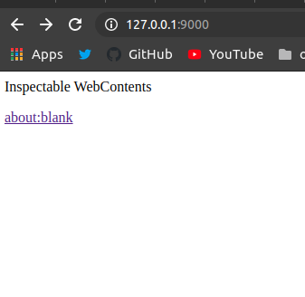
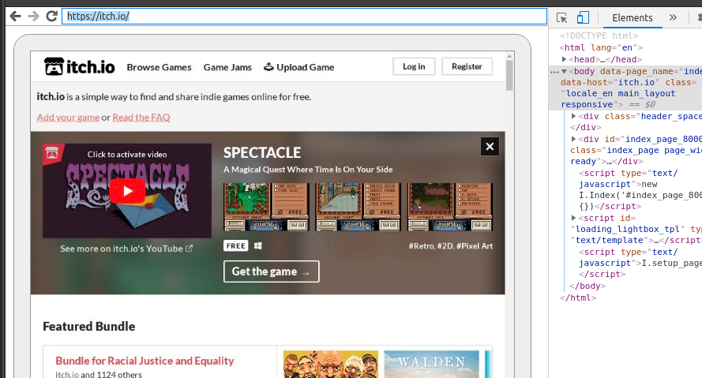

# itch.io bundle claimer

---

## 🚨⚠️ We have a message from the creator of itch.io.

Original issue: https://github.com/obsfx/itchio-bundle-claimer/issues/7#issue-5053014043

**TL;DR:** Deferred download keys from mega bundles are now fully supported by both the itch.io website and app. There is no longer any benefit to using this script, and running it may negatively affect your library and account. **The creator strongly recommends that users avoid using it.**

> When this tool first came out, there were some differences between the site and the app that meant “deferred download keys” from mega bundles could not be used in the same way as regular purchases. Since then, we’ve addressed all of these issues. We regularly have to strongly advise people not to use scripts like this and perform manual cleanup on their accounts.
>
> If possible, I’d prefer that you add a prominent disclaimer or warning advising users not to use this script, as it can negatively affect their library. It may make them more likely to hit rate limits when using the app, cause performance issues elsewhere on the site, negatively affect their recommendations, or subscribe them to game update emails from thousands of developers they likely do not care about.
>
> As far as I know, there is no advantage to running this script today. The last remaining issue was proper support for mega bundles in the app, and that feature has now launched:
> https://itch.io/updates/itch-app-bundle-support-launch-args-and-more
>
> If you believe there are still areas of the site that do not treat deferred download keys in the same way as individual purchases, please let me know.
>
> Thanks.

---

[Bundle for Racial Justice and Equality](https://itch.io/b/520/bundle-for-racial-justice-and-equality)

A simple script that is using `selenium` to help you for adding all bundle items
to your library by clicking all download buttons in place of you.


### Prerequisites

1. Download appropriate chrome driver for your operating system and add it to the PATH.
2. Add chrome to the PATH. It should be accessible as 'google-chrome'.
3. And of course nodejs and npm.

### Usage

1. Clone the repo

```
git clone https://github.com/obsfx/itchio-bundle-claimer.git
cd itchio_bundle_claimer
npm install
```

2. Run chrome in remote debugging mode

(port '9000' must be available)

```
npm run run-chrome
```

3. Open a new chrome window and type `127.0.0.1:9000` in the address bar.



4. Click that the `about:blank`

5. Type `itch.io` in that sub address bar and go to that page.



6. Login by defeating that annoying captcha. After you logged in you can close the browser.

7. Run the script.

```
node index.js --pages=<specify the page count> --url=<specify the bundle page url that listed all download buttons>
e.g.: node index.js --pages=48 --url=https://itch.io/bundle/download/sakfjasfkhaslkjfhlkajsfhgjkhlasf
```
